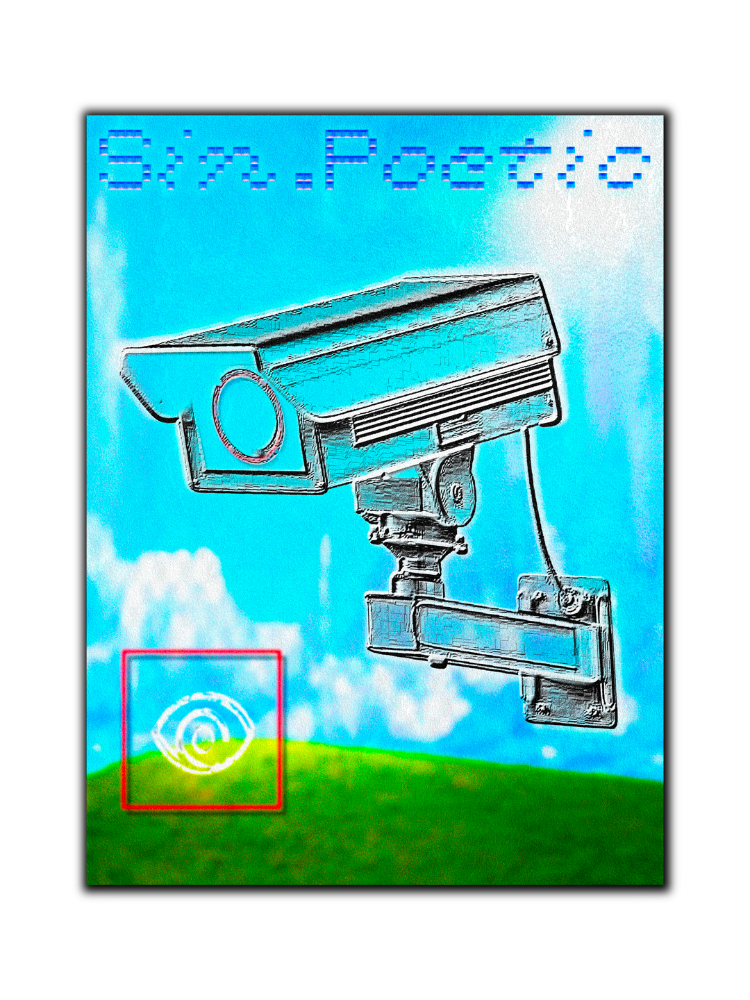
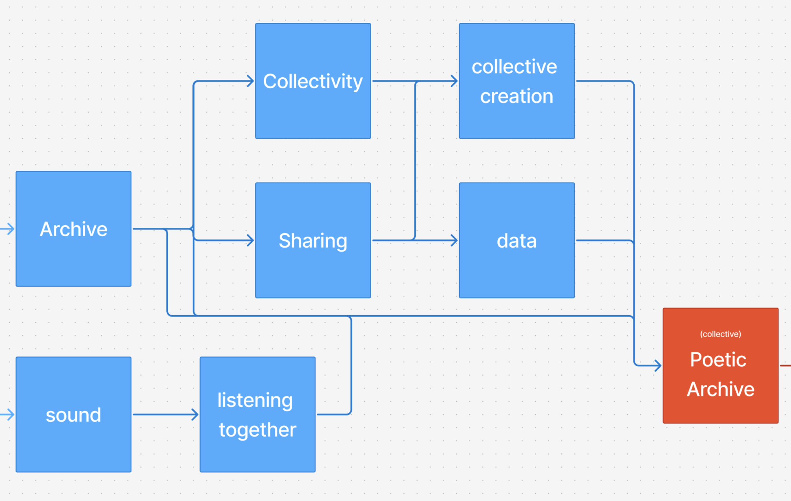
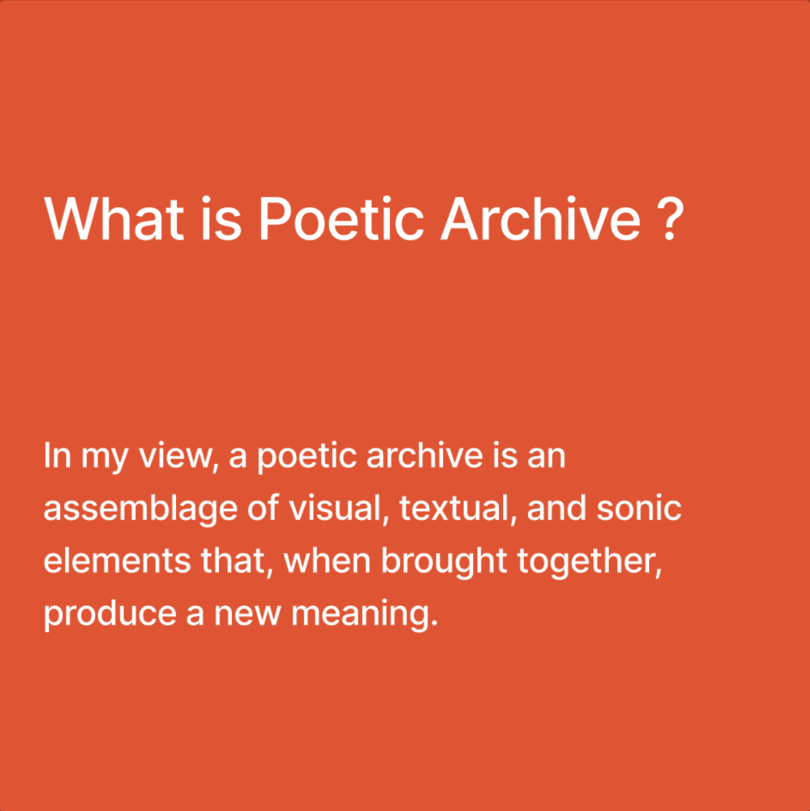
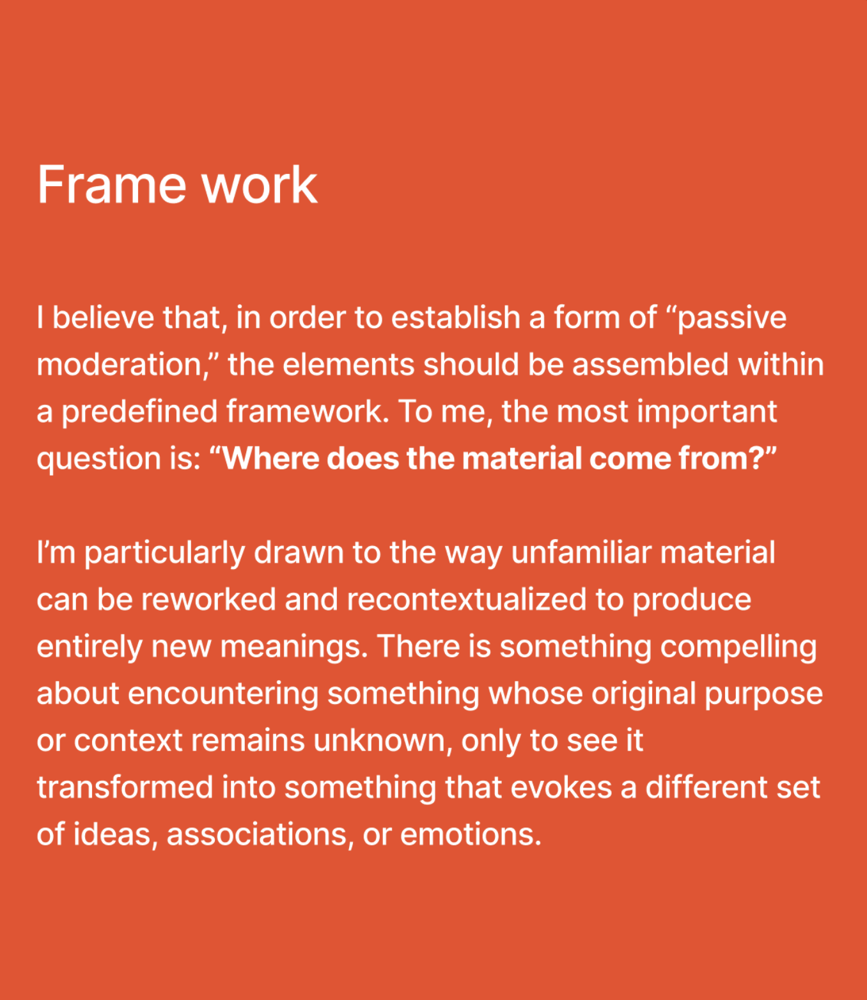
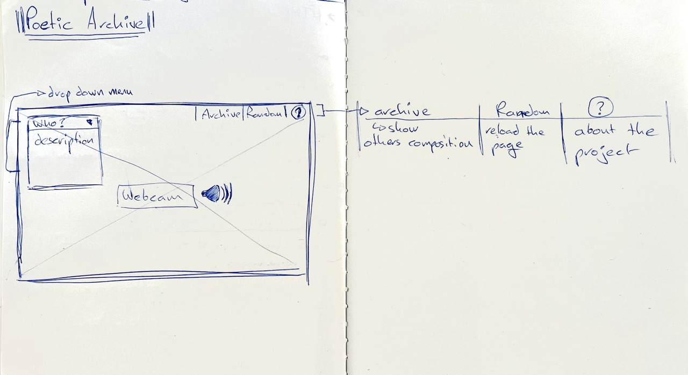
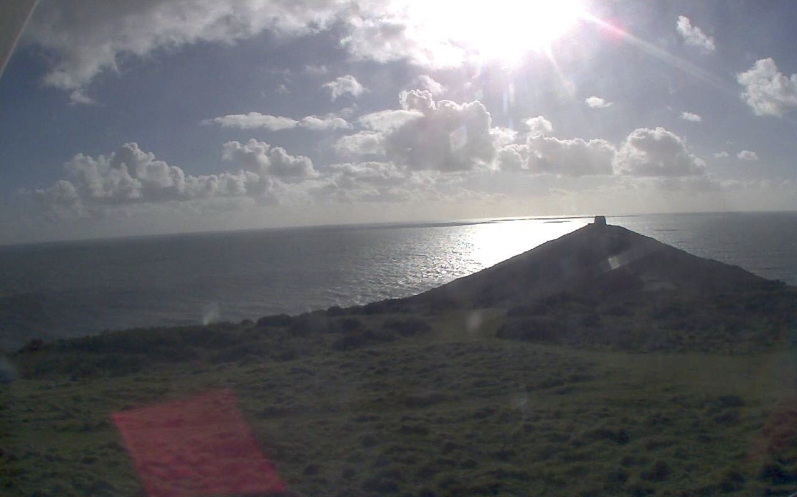
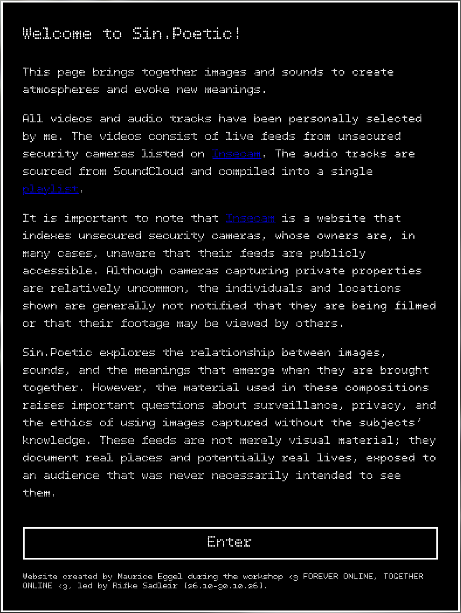
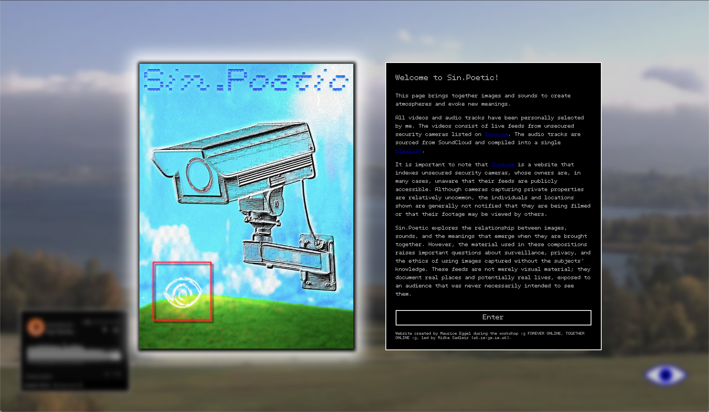
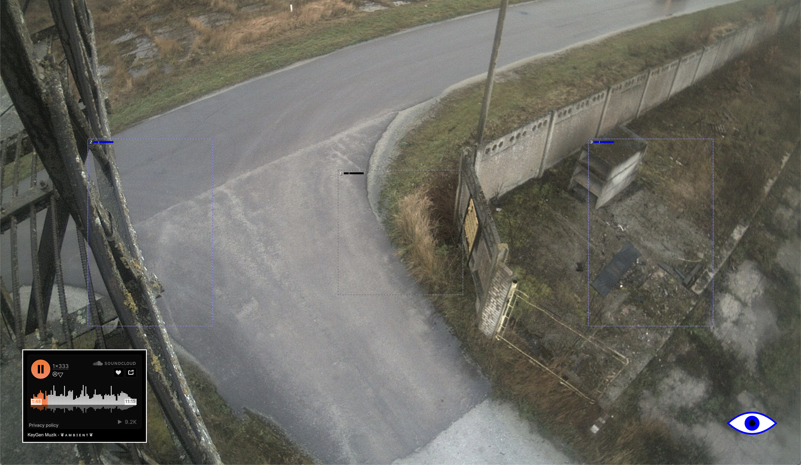

# Sin.Poetic  - Process

**Unfortunately, the site does not currently work with an HTTPS address because all the cameras have non-secure addresses (HTTP). Consequently, GitHub Pages will not be able to display the webcams 🥲.** 

**If you wish to use this website, you can download the repo and open it via the "Server Live" extension in VS Code.**

Here is a list of references used as a starting point for this project:

- [Rate Your Music](https://rateyourmusic.com/)
- [The Free Movie](https://thefreemovie.buzz/)
- [Pirate Bay](https://thepiratebay.org/index.html)
- [Soulseek](https://www.slsknet.org/news/)
- [Acoustic Camera](https://lab.acousticcameras.org/2026-1/)
- [Freesound](https://freesound.org/)
- [Bogongsound](https://index.bogongsound.com.au/archive)
- [PlazaOne](https://plaza.one/)
- [Doze FM](https://dosefm.ch/about)

 

What I like about these references is the concept of data sharing, archiving and the notion of collectivity.   

### I would like to create a website based on the concept of a (collective) poetic archive.

Mindmap made from the references

First idea for the interface. 

 
[webcam](http://82.71.13.178:8080/mjpg/video.mjpg) that I like.

## The Concept

The site features a single button that blends images and audio streams. To implement a form of "passive moderation," the site draws from a list of URLs (webcams) and a SoundCloud playlist — the content of which I have personally curated.

The site is intended to be a form of simple, immersive experience. Interpretation is left to the users.

introductory text

--> Upon entering the site, you are greeted by text and an image. To access the site, you must click the "enter" button — this will automatically start the music.

--> Once on the site, there is only one possible interaction: clicking on the eye. When you click on it, the webcam feed and the music change.

--> The audio player is located at the bottom left and allows you to find the reference for the music.